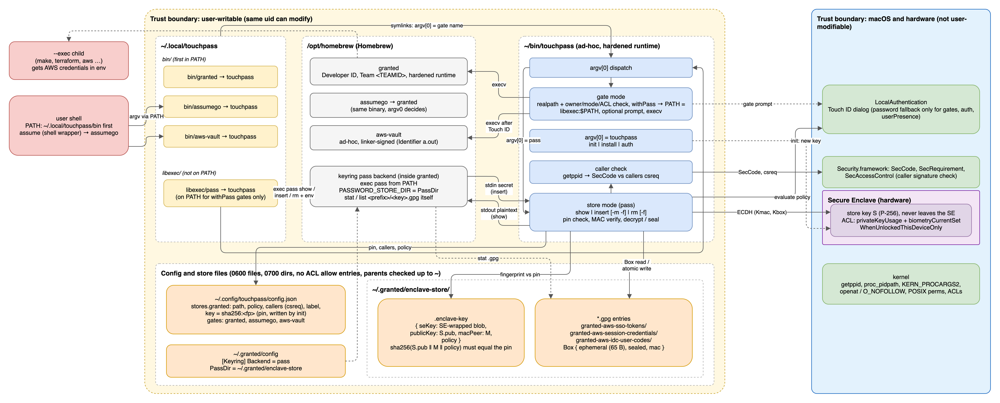
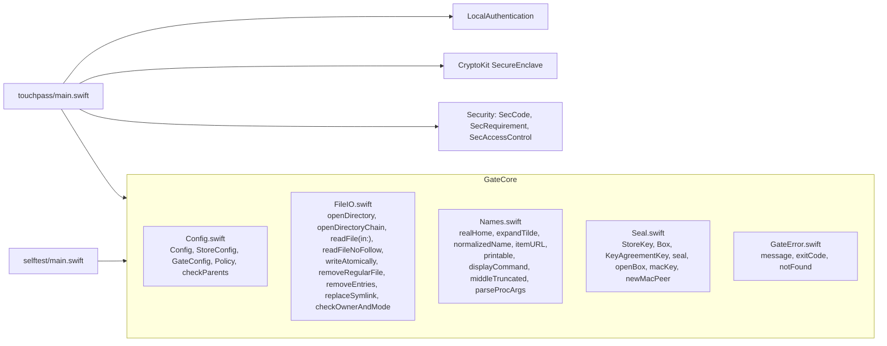
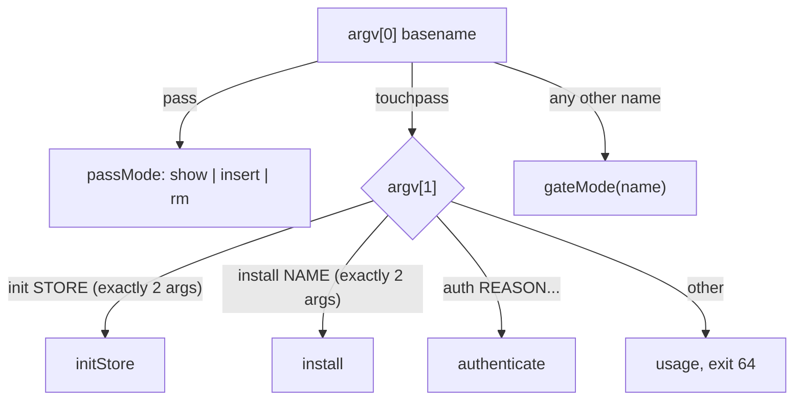
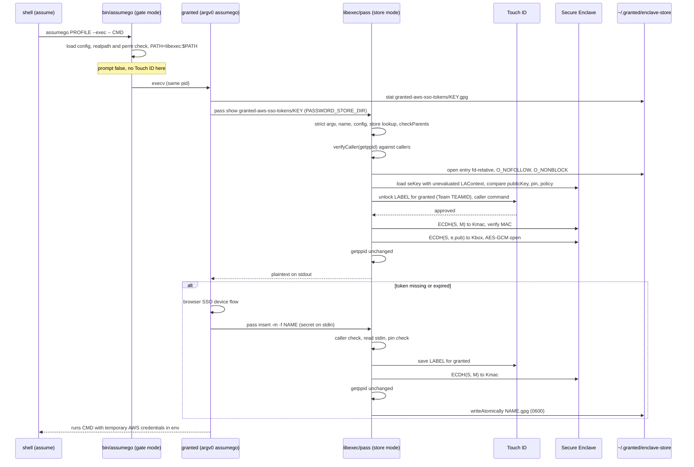
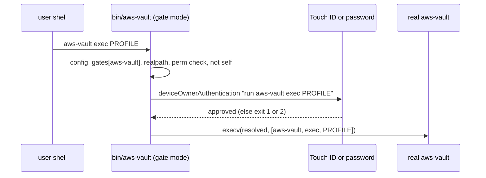

# touchpass: architecture

How the binary is built, what it stores, how it plugs into other tools, and what it defends against. Start with the [README](../README.md) for installation and the short security model.

Placeholders: `<TEAMID>` vendor team ID, `<cdhash>` code-directory hash, `<fp>` store key fingerprint. `~` is the home directory from the user database.

Diagrams (PNG exports; edit the `.drawio` sources, then re-export):

- [`overview.png`](overview.png) from [`overview.drawio`](overview.drawio): one page for users
- [`architecture-components.png`](architecture-components.png) from [`architecture.drawio`](architecture.drawio), page "Components"
- [`architecture-assume-flow.png`](architecture-assume-flow.png) from [`architecture.drawio`](architecture.drawio), page "assume flow"

[](architecture-components.png)

## 1. Architecture

### 1.1 Modules

| Target | Kind | Contents | Frameworks |
|---|---|---|---|
| `GateCore` | library | Config model and validation; fd-based file I/O; name and path rules; prompt text helpers; `KERN_PROCARGS2` parser; box and MAC crypto | Foundation, Darwin, CryptoKit |
| `touchpass` | executable | argv[0] dispatch, LocalAuthentication, Secure Enclave keys, caller verification, `init`/`install`/`auth`, gate `execv` | + LocalAuthentication, Security |
| `selftest` | executable | assert-style checks of GateCore; a software P-256 key stands in for the Secure Enclave. Run with `swift run selftest`. The Command Line Tools ship neither XCTest nor swift-testing. | GateCore only |

Pure logic that runs without hardware or UI lives in `GateCore`, and `selftest` covers it. Secure Enclave, Touch ID, code signing and `execv` live in the executable. The `KeyAgreementKey` protocol joins the two: `P256.KeyAgreement.PrivateKey` (software, selftest) and `SecureEnclave.P256.KeyAgreement.PrivateKey` (executable) both conform.



### 1.2 Multicall dispatch

One binary; the basename of `argv[0]` selects the mode (bottom of `main.swift`).



Dispatch handles `pass` and `touchpass` before gates, so `Config.validate` rejects gates with those names.

| Exit code | Meaning |
|---|---|
| 0 | success / approved |
| 1 | any error, denial, cancel, verification failure |
| 2 | authentication unavailable (`canEvaluatePolicy` false) or no Secure Enclave (`init`) |
| 64 | usage: bad argv, unsupported `pass` command or flag, invalid or escaping entry name |

### 1.3 Modes

**Store mode (`pass`)**: the subset of `pass(1)` that the 99designs/keyring pass backend calls.

| Command | Accepted flags | Auth | Effect |
|---|---|---|---|
| `pass show <name>` | none | Touch ID (store policy) | Read `<dir>/<name>.gpg`, verify pin and MAC, decrypt, plaintext to stdout. |
| `pass insert <name>` | `-m`, `-f`, `--multiline`, `--force` (optional, any order) | Touch ID (store policy) | Read stdin (max 1 MiB), seal, write `<dir>/<name>.gpg` atomically (0600, new subdirectories 0700). |
| `pass rm <name>` | `-f`, `--force` | none (caller check and pin check) | Unlink the regular file; a missing file or subdirectory counts as success. |

Exactly one non-flag argument; any other flag or command is a usage error. The store directory is `$PASSWORD_STORE_DIR` or `~/.password-store`, and it must equal a configured store `path`.

Order in `passMode`:

1. Parse argv strictly, `normalizedName`.
2. `Config.load()` (parents, perms, decode, validate).
3. `config.store(at: dir)`: an unknown directory is refused.
4. `checkParents(of: dir)`: every parent up to and including home.
5. `verifyCaller(getppid())` against the store's `callers`.
6. `itemURL` (must stay under the store); open the store directory once (`O_NOFOLLOW`, owner/mode and ACL check). Key, subdirectories and entry open relative to that fd.
7. Per command:
   - `show`: open subdirectory chain and entry (not found: "not in the password store", no prompt), decode `Box`, `pinnedKey` against a fresh unevaluated `LAContext` (never prompts), `evaluate` (one prompt), MAC key and decryption in the SE under that context, `getppid()` must be unchanged, write stdout.
   - `insert`: read stdin, `pinnedKey`, `evaluate`, MAC key, `seal`, `getppid()` must be unchanged, create subdirectory chain, `writeAtomically`.
   - `rm`: `pinnedKey` (no prompt), open chain, `removeRegularFile`.

Prompt text (store): `"<save|unlock> <label or store name> for <caller>.\n\nCommand, as the caller reports it:\n<command>\n"`. `<caller>` is the caller's signing identifier plus `(Team <TEAMID>)`, `(Apple)` for platform binaries or `(ad-hoc signed)`, and `unknown caller` without an identifier. `<command>` is the caller's `KERN_PROCARGS2` argv through `displayCommand`: control and format characters replaced, basename for argv[0], home as `~`, long `NAME=value` collapsed to `NAME=…`, middle-truncated to 200 characters.

**Gate mode (`<name>`)**: invoked through a symlink named like the real tool.

1. `Config.load()`; `gates[name]` must exist.
2. `realpath(bin)`: must be a regular file, not group/other-writable, without ACL allow entries, owned by the user or root, and not touchpass itself (compared by device and inode, so a hardlink counts).
3. `withPass`: `PATH = ~/.local/touchpass/libexec:$PATH` (or `:/usr/bin:/bin` if unset).
4. `requiresAuth(args)`: `prompt: false` means no; `only` unset means yes; no non-flag argument means yes (fail closed); otherwise the first non-flag argument must be in `only`. Prompt: `.deviceOwnerAuthentication` (Touch ID or login password), reason `run <name> <args>` (args through `printable`, 120 characters).
5. `execv(resolved, [name] + args)`: argv[0] stays the gate name, because some tools switch behaviour on it (Granted's `assumego`).

**Admin commands (`touchpass …`)**

| Command | Effect |
|---|---|
| `init <store>` | Load config; `checkParents` of the store dir; `mkdir` 0700 if missing; open it. If `key` is pinned, `.enclave-key` matches the pin, its policy equals the configured one and its blob re-derives `publicKey`: print "already initialised", done. Otherwise it never adopts what is on disk: it creates a new SE key (`kSecAttrAccessibleWhenUnlockedThisDeviceOnly` + `privateKeyUsage` + policy flag) and a new `macPeer`, removes every `*.gpg` below the store (no symlink following; a foreign-writable or unreadable subdirectory stops `init` before it writes the new key), writes `.enclave-key`, pins the fingerprint in `stores.<store>.key` and saves the config. |
| `install <name>` | `name` must be `pass` or a configured gate. Creates `~/.local/touchpass/bin` (gate) or `…/libexec` (`pass`) with 0755, `checkDirectory`, then points `<dir>/<name>` at the resolved own executable, replacing only a missing path or a symlink. For gates, prints a hint if `bin` is not first in `PATH`. |
| `auth <reason…>` | `.deviceOwnerAuthentication` with the reason (through `printable`); exit 0 on approval. |

### 1.4 Data formats

All `Data` fields are base64 strings (Foundation `JSONEncoder`).

**`<store>/.enclave-key`** (`StoreKey`, 0600, sorted keys, read cap 64 KiB, owner/mode and ACL checked)

| Field | Content |
|---|---|
| `seKey` | `SecureEnclave.P256.KeyAgreement.PrivateKey.dataRepresentation`: a blob wrapped by this Mac's Secure Enclave, not the private key. |
| `publicKey` | X9.63 P-256 public key of the SE key (65 bytes). |
| `macPeer` | X9.63 public key of a software P-256 key whose private half `init` discarded. A key without it has no fingerprint and is refused. |
| `policy` | The policy the SE key was created with. A key file without it is refused until `init` replaces it. |

Fingerprint = `"sha256:" + hex(SHA256(publicKey ‖ macPeer ‖ policy))`.

**`<store>/<name>.gpg`** (`Box`, 0600, read cap 2 MiB). The `.gpg` suffix exists because keyring's pass backend checks and lists entries by it; the content is JSON, not OpenPGP. touchpass does not check owner and mode of entries (the MAC covers integrity); it checks the directories on the way.

| Field | Content |
|---|---|
| `ephemeral` | X9.63 public key of the per-entry ephemeral P-256 key; must be 65 bytes. |
| `sealed` | AES-GCM combined: 12-byte nonce ‖ ciphertext ‖ 16-byte tag. |
| `mac` | HMAC-SHA256 (32 bytes). A missing MAC is refused ("log in again"). |

**`~/.config/touchpass/config.json`**: fixed path under the home from the user database, no environment override. Regular file, not a symlink, not group/other-writable, no ACL allow entries, owned by the user or root, max 1 MiB; every parent up to and including home likewise (deny entries, such as the one macOS puts on home, are fine). Unknown keys are ignored on load and dropped when `init` saves.

| Field | Type | Default | Rules |
|---|---|---|---|
| `stores` | object | `{}` | |
| `stores.*.path` | string | required | Absolute or `~/…`; must not equal, contain or sit inside another store. Existing directories compare by device and inode (catches case, Unicode and `/System/Volumes/Data` aliases), missing ones by Unicode case-folded name. |
| `stores.*.policy` | `biometryCurrentSet` \| `biometryAny` \| `userPresence` | `biometryCurrentSet` | Baked into the SE key's access control at `init`; a mismatch with the key blocks the store. |
| `stores.*.callers` | [csreq string] | `[]` = nobody | Code-signing requirements the parent process must satisfy. |
| `stores.*.label` | string | store name | Shown in the prompt. |
| `stores.*.key` | string | none | Fingerprint pin written by `init`. `show`/`insert`/`rm` refuse while it is absent or mismatched. |
| `gates` | object | `{}` | Names `pass` and `touchpass` are reserved. |
| `gates.*.bin` | string | required | Absolute path of the real binary (resolved with `realpath` at run time). |
| `gates.*.only` | [string] | unset = always | Prompt only if the first non-flag argument is listed; no non-flag argument means prompt. Must not be empty. |
| `gates.*.prompt` | bool | `true` | `false` = no prompt of its own. |
| `gates.*.withPass` | bool | `false` | Prepend the private libexec dir to the tool's `PATH`. |

Every security default is the stricter choice, so a misspelled `callers`, `prompt`, `policy` or `key` fails closed (no callers, always prompt, strictest policy, not initialised). A misspelled `withPass` leaves the tool with whatever `pass` is on its `PATH`.

Example config for Granted:

```json
{
  "gates": {
    "assumego":  { "bin": "/opt/homebrew/bin/assumego", "prompt": false, "withPass": true },
    "aws-vault": { "bin": "/opt/homebrew/opt/aws-vault/bin/aws-vault" },
    "granted":   { "bin": "/opt/homebrew/bin/granted", "prompt": false, "withPass": true }
  },
  "stores": {
    "granted": {
      "callers": ["identifier \"granted\" and anchor apple generic and certificate 1[field.1.2.840.113635.100.6.2.6] and certificate leaf[field.1.2.840.113635.100.6.1.13] and certificate leaf[subject.OU] = \"<TEAMID>\""],
      "key": "sha256:<fp>",
      "label": "your AWS SSO login",
      "path": "~/.granted/enclave-store",
      "policy": "biometryCurrentSet"
    }
  }
}
```

Entry names: no leading `/`, no `.` or `..` segment, empty segments collapsed as Go's `filepath.Join` does (`granted-aws-sso-tokens/https://…` becomes `https:/…`), must stay under the store. A name starting with `-` cannot be passed, because it reads as a flag.

### 1.5 Crypto

Primitives: P-256 ECDH, HKDF-SHA256, AES-256-GCM, HMAC-SHA256 (CryptoKit). `S` = store SE key (private in the SE, `S.pub` on disk). `M` = macPeer (public only).

**init**

1. `S` = new SE P-256 key-agreement key, access control `WhenUnlockedThisDeviceOnly` + `privateKeyUsage` + policy flag.
2. `m` = new software P-256 key; keep `M = m.pub`; `m` is dropped when `newMacPeer()` returns.
3. Write `{seKey, publicKey: S.pub, macPeer: M, policy}`; pin `fp = SHA256(S.pub ‖ M ‖ policy)` in the config.

**pin check** (`pinnedKey`, every `pass` command): `key` present, load `.enclave-key`, load `seKey` into the SE with an unevaluated `LAContext`; the re-derived public key must equal `publicKey`, the fingerprint must equal the pin, and the key's policy must equal the configured one.

**MAC key** (needs the SE, therefore an evaluated context)

```
Kmac = HKDF-SHA256(ikm = ECDH(S, M), salt = "touchpass mac v1", info = M, len = 32)
```

`ECDH(S, M) = ECDH(m, S.pub)`; with `m` discarded, only the SE can compute it.

**seal** (`insert`)

```
e      = fresh ephemeral P-256 key
Z      = ECDH(e, S.pub)
Kbox   = HKDF-SHA256(ikm = Z, salt = e.pub, info = "touchpass entry v1 " + name, len = 32)
sealed = AES-GCM(Kbox, random nonce, plaintext)            no AAD
mac    = HMAC-SHA256(Kmac, "touchpass mac v1" 0x00 name 0x00 ‖ e.pub ‖ sealed)
box    = {ephemeral: e.pub, sealed, mac}
```

**open** (`show`): a missing `mac` is refused; an `ephemeral` that is not 65 bytes is refused (the MAC input relies on its fixed length to separate it from `sealed`); verify the HMAC (CryptoKit, constant time); `Z = ECDH(S, e.pub)` in the SE; derive `Kbox`; AES-GCM open.

| Binding | Mechanism | Prevents |
|---|---|---|
| entry ↔ store key | ECDH with `S`; `Kmac` from `S` | decrypting elsewhere, entries from another store |
| entry ↔ its name | name in HKDF info and MAC input | moving a box to another name |
| entry ↔ written by the SE holder | `Kmac` needs `ECDH(S, M)` | planting a box built from `S.pub` alone |
| ephemeral/sealed boundary | 65-byte check | shifting bytes between the two fields under the same MAC |
| `.enclave-key` ↔ config | fingerprint over `S.pub ‖ M ‖ policy`; `S.pub` re-derived from `seKey` | swapping the key file, the macPeer or the recorded policy |
| not bound | time, counter, store name | rollback to an older genuine box |

Encryption needs only `S.pub`; `insert` still prompts because `Kmac` needs the SE.

### 1.6 Sequence: `assume` → Granted → `pass`

Granted's `assume` is a shell wrapper that runs `assumego` from `PATH`; `assumego` is the `granted` binary under another name. Granted's keyring pass backend (`[Keyring] Backend = "pass"`, `PassDir` in `~/.granted/config`) runs `pass` from `PATH` with `PASSWORD_STORE_DIR = PassDir`, and checks and lists entries as `<dir>/<prefix>/<key>.gpg` itself.



Granted keeps `granted-aws-sso-tokens/`, `granted-aws-session-credentials/` and `granted-aws-idc-user-codes/` in the store, so one `assume` can cause several `pass` calls. Each is a new process with its own prompt (no `LAContext` reuse).

### 1.7 Sequence: gate with prompt



## 2. Integration points

### 2.1 Ways to plug in

| Integration | Tool requirement | Protection |
|---|---|---|
| Store (pass-compatible) | Calls `pass show`, `pass insert [-m] [-f]` (secret on stdin), `pass rm [-f]` with `PASSWORD_STORE_DIR` = a configured store. Finds entries by `<dir>/<name>.gpg` or only via `show`. Has a stable code signature. | Cryptographic: SE key + Touch ID + pin + MAC; caller check as a hurdle. |
| Gate | Any CLI. A link named like the tool, earlier in `PATH`. | Advisory: prompt before `execv`; running the real path bypasses it. |
| `touchpass auth` | Scripts: `touchpass auth "deploy production" && make deploy`. | Advisory: exit code only; login password accepted. |

Other keyring users can use a store as well, e.g. aws-vault with `AWS_VAULT_BACKEND=pass`, `AWS_VAULT_PASS_CMD=~/.local/touchpass/libexec/pass` and `AWS_VAULT_PASS_PASSWORD_STORE_DIR=<store>`. Each needs its own store and `callers` entry; see 2.3 for why an ad-hoc signed caller makes a weak requirement.

### 2.2 Adding a store integration

1. Add `stores.<name>` with a unique `path` and a `label`; keep the default `policy` unless you need a password fallback.
2. Add the caller requirement to `callers` (2.3).
3. Run `touchpass init <name>` (creates the directory, key and pin).
4. Make the tool find touchpass's `pass`: a gate with `withPass: true` plus `touchpass install <tool>` and `touchpass install pass`, or a tool option pointing at `~/.local/touchpass/libexec/pass`.
5. Point the tool at the store directory (`PASSWORD_STORE_DIR` or the tool's own option).

### 2.3 Caller requirements

Get the requirement with `codesign -d -r- <real binary>` and copy the expression after `designated =>`. For Granted:

```
designated => identifier granted and anchor apple generic
  and certificate 1[field.1.2.840.113635.100.6.2.6] /* exists */
  and certificate leaf[field.1.2.840.113635.100.6.1.13] /* exists */
  and certificate leaf[subject.OU] = <TEAMID>
```

Use the designated requirement verbatim. A shorter form without the two Developer ID OID markers accepts any Apple-issued certificate of that team with identifier `granted`.

| Caller signature | Requirement form | Stability |
|---|---|---|
| Developer ID (Granted: team-signed, hardened runtime) | the full designated requirement from `codesign -d -r-` (above) | survives upgrades |
| ad-hoc / linker-signed (Homebrew-built, e.g. aws-vault: `Identifier=a.out`, `flags=adhoc,linker-signed`) | `cdhash H"<cdhash>"` | changes with every build; each `brew upgrade` breaks access until you update it |
| Apple platform binaries (ssh, sudo, CLT git) | `anchor apple and identifier "com.apple.…"` | survives OS updates |

A caller without hardened runtime (aws-vault) accepts code injected by same-user processes (`DYLD_*`), so its requirement keeps out other binaries, not code running inside the trusted one.

### 2.4 PATH and libexec layout

```
~/bin/touchpass                           binary (ad-hoc signed, hardened runtime)
~/.local/touchpass/bin/                   first in PATH
    granted   -> ~/bin/touchpass          gate, prompt false, withPass
    assumego  -> ~/bin/touchpass          gate, prompt false, withPass
    aws-vault -> ~/bin/touchpass          gate, prompt
~/.local/touchpass/libexec/               not in PATH
    pass      -> ~/bin/touchpass          store mode; on PATH only for withPass gates
/opt/homebrew/bin/{granted,assumego,aws-vault}   real binaries (assumego -> granted)
~/.config/touchpass/config.json           config (0600)
~/.granted/enclave-store/                    store (0700): .enclave-key, <prefix>/<key>.gpg
```

Put `~/.local/touchpass/bin` in front of anything that adds shims (pyenv, asdf), so the shims cannot shadow the gates.

libexec stays private for three reasons: a global `pass` would shadow a real `pass` for every program; tools that are not store callers would reach touchpass's `pass` and fail with caller or store-lookup errors; and the set of processes that talk to the store stays small.

Coexistence with a real `pass`:

| Who | `pass` resolves to |
|---|---|
| shells and ordinary tools | real `pass` |
| Granted started through its gates | touchpass (libexec prepended) |
| children of a `withPass` tool, e.g. the `assume --exec` command | touchpass, if the tool passes its environment through |
| a `withPass` tool that wants the real `pass` for `~/.password-store` | touchpass, which refuses unless that directory is a configured store |

The real `pass` cannot read touchpass stores (JSON, not GPG). touchpass implements only `show`, `insert` and `rm`; `ls`, `find`, `git`, `generate` and `edit` are usage errors.

## 3. Threat model

"Same-user" means a process running under your uid.

| Attacker capability | Protected | Why |
|---|---|---|
| other local user | yes | 0600/0700, owner/mode and ACL checks up to home |
| copy of the disk, backup, Time Machine | yes | entries encrypted to an SE key; `seKey` unusable elsewhere; ThisDeviceOnly |
| same-user process reads store files | yes | ciphertext only |
| same-user process runs `libexec/pass show` | yes | parent is not a trusted caller |
| same-user process plants a forged entry (token for its own account) | yes, until it has won one approval | `Kmac` needs `ECDH(S, M)`, `m` discarded; see the blob row below |
| moves an entry to another name | yes | name in HKDF info and MAC |
| shifts bytes between `ephemeral` and `sealed` | yes | 65-byte check |
| swaps `.enclave-key` (own SE key, own macPeer, edited policy) | yes | pin over key, macPeer and policy; public key re-derived from the blob |
| changes `policy` in the config without a new key | yes | pin check compares the key's policy; the store refuses until `init` |
| plants `.enclave-key` before `init` | yes | `init` never adopts; it creates a new key unless the existing one matches the pin and policy |
| sets `HOME`/`CFFIXED_USER_HOME` | yes | home from the user database |
| sets `PASSWORD_STORE_DIR` to its own directory | yes | must equal a configured store |
| symlinks or renames inside the store, FIFO as entry | yes | fd-relative `O_NOFOLLOW` opens, type checks, `O_NONBLOCK` |
| directory named `<x>.gpg` so `rm` deletes a tree | yes | `removeRegularFile` refuses non-regular files |
| newlines / bidi overrides in argv to fake prompt lines | mitigated | `printable`; caller identity from its code signature. Argv content stays caller-chosen and the prompt labels it so |
| huge stdin, entry or config | yes | 1 MiB stdin, 2 MiB entry, 64 KiB key, 1 MiB config |
| code injection into touchpass | yes | hardened runtime |
| replaces `/opt/homebrew/bin/granted` | yes for the store | fails the team requirement; the gate would still exec it |
| spawns `pass`, then execs into Granted (same pid) | no | pid-based check; Touch ID remains the barrier |
| runs `assume`/Granted itself | no (by design) | a trusted binary doing its job; the prompt names Granted and the command |
| uses the `.enclave-key` blob directly via CryptoKit | no, after one approval | the SE ACL still requires Touch ID, but the attacker writes the prompt text. One approval lets it run every ECDH in that context: it decrypts all entries and derives `Kmac`, which is static, so it can forge entries afterwards without further approvals |
| changes the calling tool's config (`~/.granted/config`: `Backend`, `PassDir`) | no (out of scope) | the tool then stores its secrets elsewhere; a check in the gate would be check-then-use against the same uid |
| rolls back an entry to an older genuine version | no | nothing binds time or a counter |
| deletes entries or the store | no | `rm` needs no prompt, and the same uid can unlink anyway. Result: a new login, not disclosure |
| rewrites config (pin, callers) and `.enclave-key`, waits for the next login | no (out of scope) | same-user writable; new entries would be sealed to the attacker's key |
| replaces `~/bin/touchpass` or a link | no (out of scope) | same-user writable, not verified |
| runs the real binary instead of a gate | no (by design) | gates are a convenience prompt |
| `only` bypass with space-separated flag values (`git -C dir push`) | no | the first non-flag argument counts as the subcommand |
| enrols own fingerprint (knows the password, physical access) | yes for `biometryCurrentSet`, no for `biometryAny`/`userPresence` | an enrolment change invalidates only `biometryCurrentSet` keys |
| reads plaintext from the caller after `show` | no | outside touchpass |
| root or kernel compromise | no | can drive callers and wait for approval; the SE still keeps `S` unextractable |

Binding the SE key to touchpass itself, so that other same-user processes cannot use the blob, needs the data-protection keychain with a keychain access group (Developer ID plus a provisioning profile). CryptoKit blobs cannot carry an access group, and an ad-hoc build cannot have one.
